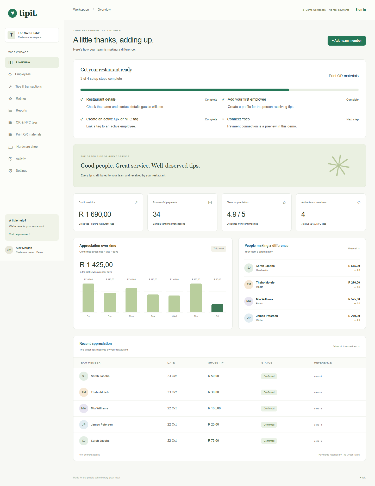

# Tipit

**A little thanks goes a long way.**

Cashless tipping and guest reviews for restaurants. Guests scan a QR code or tap an NFC tag, choose an employee’s tip amount, and leave a star rating with an optional written review. Restaurant managers manage their team, links, and activity from one workspace.


[](LICENSE)

[Quickstart](#quickstart) · [Demo](#try-the-demo) · [Feature status](#feature-status) · [Configuration](#configuration) · [Development](#development) · [Documentation](#documentation)

## Overview

- **Restaurant workspaces:** Clerk authentication, owner/manager access, and restaurant-scoped Neon data.
- **Employee management:** staff profiles, individual tipping links, and soft deletion that preserves history.
- **QR and NFC tools:** generate QR codes, download them, and activate or suspend permanent tag links.
- **Ratings and reviews:** individual submissions in a searchable table with employee, star, date, written-review, and source filters.
- **Transaction reporting:** payment history, filters, CSV export, and clearly labelled test payments.
- **Client demonstrations:** a public demo workspace that stays separate from connected restaurant data.
- **Guided setup:** a checklist for restaurant details, staff, active tags, and Yoco configuration.
- **Employee insights:** date-filtered tip history, review breakdowns, and assigned tags in one profile.
- **Print and reporting:** QR cards/table stands, period comparisons, and employee summary exports.
- **Team and activity:** owner-managed Clerk membership and restaurant-scoped change history.

Tips go to each restaurant’s own Yoco account. Restaurant management handles staff distribution and processing fees; Tipit does not provide employee wallets or payroll.

<details>
<summary><strong>Dashboard preview</strong> — sample restaurant workspace</summary>



_Browser demo data shown; no real customer transactions._

</details>

## Account access and onboarding

`/sign-in` and `/sign-up` use Clerk when configured. Each page also offers **Explore demo** and **Try onboarding demo**. Sign-in links and old `/demo/sign-in` or `/demo/sign-up` URLs lead to canonical account pages, so demo navigation never substitutes for authentication.

New users register → complete Clerk organization selection/creation → enter restaurant details → open an empty connected dashboard. Existing restaurants keep their records. For a client presentation, `/demo/onboarding` starts with blank restaurant details and replaces only this browser’s sample workspace with an empty demo when submitted. It creates no Clerk account or database records; **Settings → Demo controls → Reset demo data** restores the populated example.

Keep `NEXT_PUBLIC_AUTH_MODE=auto` (or `clerk` with both keys) and `TIPIT_STORAGE=auto` with Neon configured for real account onboarding. An explicit demo-only build cannot authenticate accounts; its account pages say access is unavailable and keep the demo options visible.

## Feature status

| Area                  | Status                  | Details                                                                                                                                             |
| --------------------- | ----------------------- | --------------------------------------------------------------------------------------------------------------------------------------------------- |
| Landing page          | **Built**               | Includes pricing and how it works. Prices are illustrative.                                                                                         |
| Public demo           | **Available**           | No sign-in; sample data stays in browser storage.                                                                                                   |
| Authentication        | **Built**               | Clerk sign-in and restaurant workspaces; requires local credentials.                                                                                |
| Restaurant database   | **Built**               | Neon/PostgreSQL persistence and restaurant isolation.                                                                                               |
| Staff and tags        | **Built**               | Profiles, QR downloads, tag suspension, and archival.                                                                                               |
| Reviews and reporting | **Built**               | Stars, optional text, filters, and transaction CSV exports.                                                                                         |
| Yoco payments         | **Needs configuration** | Checkout, signed webhooks, receipts, and refunds are implemented. Actual Yoco testing still requires an account, keys, and a public HTTPS endpoint. |
| Subscriptions         | **Preview**             | Monthly billing and plan enforcement are not connected.                                                                                             |
| Hardware orders       | **Drafts only**         | Catalogue selections create unpaid drafts; checkout and fulfilment are not implemented.                                                             |
| Legal pages           | **Drafts**              | Require review before launch.                                                                                                                       |

> **Payment status:** the local project currently uses simulated payments. Configuring Neon and Clerk does not automatically enable real charges.

## Quickstart

### Requirements

- Node.js compatible with Next.js 15.
- pnpm.
- Clerk and Neon credentials only if you want connected restaurant workspaces.

### Start locally

```sh
pnpm install
pnpm dev
```

Open [localhost:3000](http://localhost:3000). Without credentials, the app runs with browser demo data.

For environment variables, use [`.env.example`](.env.example) as the template for your local `.env.local`. Preserve any existing credentials when updating that file.

### Production preview

```sh
pnpm build
pnpm start --port 3001
```

Open [localhost:3001](http://localhost:3001). Stop the running server before rebuilding its output directory.

## Try the demo

Open **`/demo/dashboard`** on your running app. This link works without signing in, including when Clerk and Neon are connected.

1. Review the sample dashboard, staff, and transactions.
2. Open **`/demo/t/GT-001`**, choose an amount, and simulate a successful payment.
3. Submit stars and an optional written review.
4. Return to **`/demo/dashboard/ratings`** and try the table filters.
5. Create an employee, generate a tag, and download its QR code.
6. Archive an employee to suspend their tags, or reset the demo in **Settings → Demo controls**.

**Storage:** demo workspace changes stay in the current browser and origin. They do not sync between devices or enter Neon. Connected-page payment simulations are also browser-only and are labelled separately in Ratings.

**Tags:** `GT-001`, `GT-002`, and `GT-003` start active; `GT-004` starts suspended. NFC tags store the same destination URL as QR codes and require separate programming. Use a reachable deployment or LAN address when demonstrating with a phone.

## Configuration

### Environment modes

| Variable                | Values                      | Purpose                                                                             |
| ----------------------- | --------------------------- | ----------------------------------------------------------------------------------- |
| `NEXT_PUBLIC_AUTH_MODE` | `auto`, `clerk`, `demo`     | Enable configured Clerk authentication, require it explicitly, or use demo access.  |
| `TIPIT_STORAGE`         | `auto`, `database`, `demo`  | Use configured PostgreSQL storage, require it explicitly, or use browser storage.   |
| `TIPIT_MODE`            | `demo`, `yoco_test`, `live` | Select simulated checkout, Yoco sandbox, or real payments.                          |
| `NEXT_PUBLIC_APP_URL`   | Application origin          | Set the browser return URL and webhook origin. Yoco callbacks require public HTTPS. |

**Connected workspace:** set Clerk keys and `DATABASE_URL`, keep authentication/storage in `auto`, and complete restaurant onboarding. Database failures are shown explicitly rather than substituted with sample data.

**Offline demo:** use `NEXT_PUBLIC_AUTH_MODE=demo`, `TIPIT_STORAGE=demo`, and `TIPIT_MODE=demo`.

**Yoco:** credentials are configured separately for each restaurant. Test payments are labelled and excluded from live totals and public star averages. Follow the [Yoco setup guide](docs/yoco.md) before changing payment mode.

Keep `.env.local` private. Restart after configuration changes, and rebuild production previews when public configuration changes. Credentials must never be committed or exposed through client-side payment code.

### Business rules

- Owners and managers access the workspace; employees do not need accounts at launch.
- Each tip belongs to one employee and is received through the restaurant’s merchant connection.
- A confirmed payment can receive one optional star rating and written review.
- Archiving an employee suspends their tags and retains historical transactions.
- Restoring an employee does not automatically reactivate suspended tags.
- Real payment state is confirmed by signed provider notifications, not browser redirects.

## Project structure

```text
src/
├── app/                    # Routes, layouts, styles, and API endpoints
├── components/
│   ├── dashboard/          # Workspace layout and management pages
│   ├── public/             # Landing, pricing, access, and information pages
│   ├── tipping/            # Employee tipping and payment receipts
│   ├── data-table.tsx      # Shared table rendering and empty states
│   ├── filter-select.tsx   # Reusable filter dropdowns
│   ├── review-form.tsx     # Shared review form, stars, and confirmation
│   └── workspace-context.tsx
├── hooks/                  # Browser state synchronisation
└── lib/
    ├── db/                 # Schema, workspace and payment repositories
    ├── integrations/       # Clerk and Yoco server integrations
    ├── csv.ts              # Safe CSV generation and downloads
    └── format.ts           # Date labels and filter keys

docs/                       # Architecture, database, and Yoco guides
drizzle/                    # Reviewed database migrations
scripts/                    # Database checks, migrations, and Yoco setup
tests/                      # Browser, helper, and isolated database tests
```

See [Component structure](docs/code-structure.md) for shared component APIs and state boundaries.

## Main routes

| Route                                 | Purpose                                                |
| ------------------------------------- | ------------------------------------------------------ |
| `/`                                   | Landing page with pricing and how it works             |
| `/demo/dashboard`                     | Public, browser-only demo workspace                    |
| `/dashboard`                          | Authenticated restaurant overview                      |
| `/dashboard/employees`                | Staff management and individual profiles               |
| `/dashboard/tips`                     | Transaction table, filters, and CSV export             |
| `/dashboard/ratings`                  | Ratings and written-review table                       |
| `/dashboard/tags`                     | QR/NFC links and tag controls                          |
| `/dashboard/settings`                 | Restaurant details, team, and connection status        |
| `/dashboard/reports`                  | Gross tips, refunds, comparisons, and employee exports |
| `/dashboard/print`                    | Printable employee QR cards and table stands           |
| `/dashboard/activity`                 | Restaurant-scoped change history                       |
| `/dashboard/updates`                  | Dated product history grouped by development batch     |
| `/dashboard/hardware`                 | Catalogue and unpaid draft orders                      |
| `/t/[code]`                           | Permanent QR/NFC tipping destination                   |
| `/r/[restaurantSlug]/[employeeId]`    | Individual employee tipping page                       |
| `/payment/[reference]`                | Payment receipt and eligible review submission         |
| `/sign-in`, `/sign-up`, `/onboarding` | Authentication and restaurant setup                    |

Public staff directories and leaderboards are outside the current scope. Individual employee tipping pages remain public.

## Development

### Formatting and code quality

```sh
pnpm format
pnpm format:check
pnpm lint
pnpm typecheck
```

Prettier is pinned in development dependencies. [`.prettierrc.json`](.prettierrc.json) defines formatting, [`.editorconfig`](.editorconfig) aligns editor settings, and [`.prettierignore`](.prettierignore) excludes generated files, migration artefacts, secrets, and build output.

### Tests and database tools

| Command                         | Purpose                                                      |
| ------------------------------- | ------------------------------------------------------------ |
| `pnpm test:e2e`                 | Browser and helper checks; build the app first.              |
| `pnpm test:db`                  | Repository and provider tests in isolated PGlite, not Neon.  |
| `pnpm test:functional`          | Database suite followed by the selected browser suite.       |
| `pnpm db:check`                 | Check the configured database connection.                    |
| `pnpm db:generate`              | Generate a migration after schema changes.                   |
| `pnpm db:migrate`               | Apply reviewed migrations to the configured database.        |
| `pnpm yoco:webhook org_REPLACE` | Register a test webhook and save its signing secret locally. |

The default browser suite expects an offline-demo build. Setting `CLERK_TEST_LIVE=1` selects the connected-app suite instead. Browser tests use Microsoft Edge; see [database and testing details](docs/database.md) before running connected checks.

## Documentation

| Guide                                         | Covers                                                                            |
| --------------------------------------------- | --------------------------------------------------------------------------------- |
| [Component structure](docs/code-structure.md) | Feature folders, reusable UI, workspace state, and formatting                     |
| [Database and access rules](docs/database.md) | Neon setup, schema, tenant isolation, migrations, and tests                       |
| [Yoco integration](docs/yoco.md)              | Merchant configuration, test checkout, webhooks, receipts, and live prerequisites |
| [Functional testing](docs/testing.md)         | Superuser console, isolated checks, CLI commands and coverage limits              |

## Pilot readiness

Before a restaurant pilot, follow the [pilot checklist](docs/pilot-checklist.md) for account setup, membership checks, legal review, monitoring, and a database restore drill.

## Functional testing console

The **Testing** sidebar item opens `/dashboard/testing` for the verified Clerk account **jaydenoerson95@gmail.com** only. Run database and browser workflows with per-test results. The public demo and other restaurant accounts cannot access it. Local runner setup, feature coverage and external checks are documented in [the testing guide](docs/testing.md).

## License

Licensed under [MIT](LICENSE).
